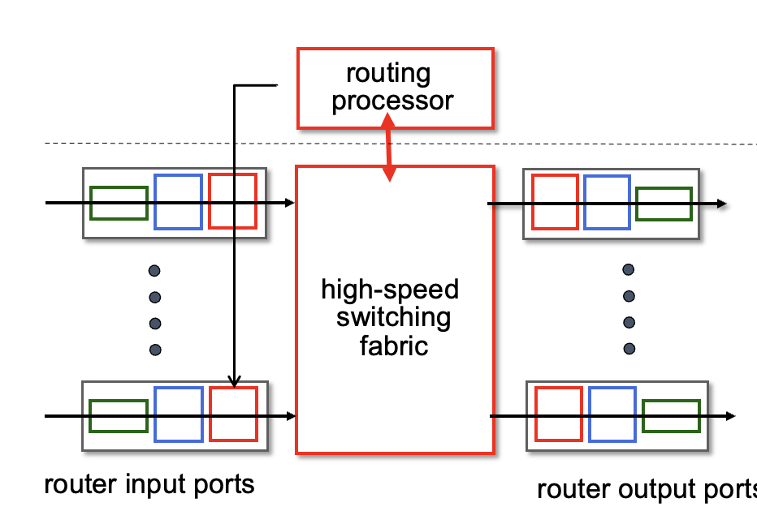
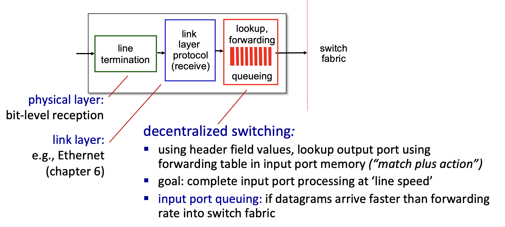
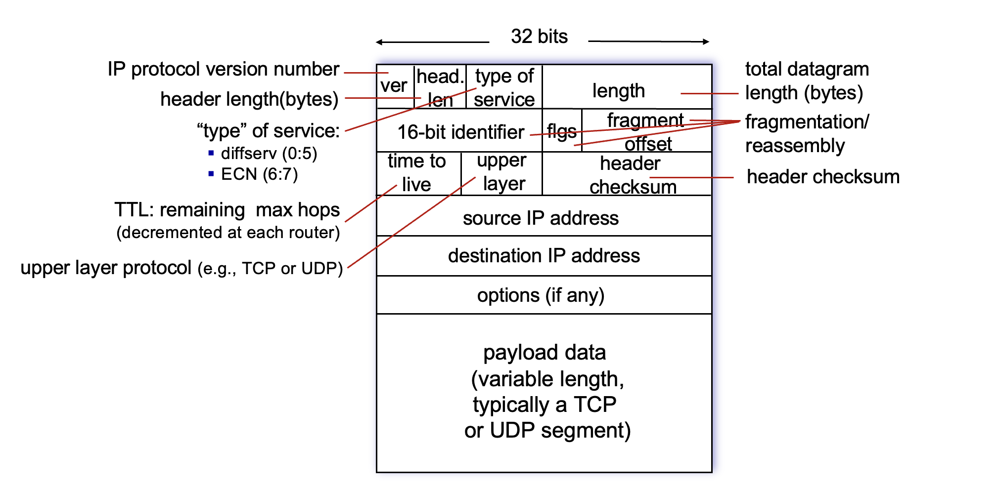
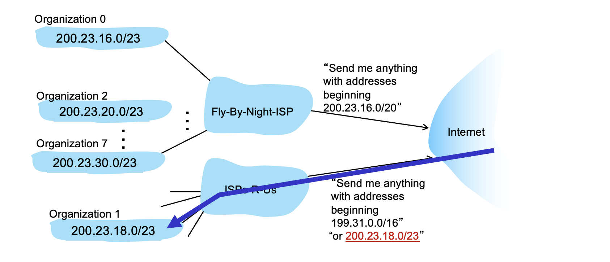
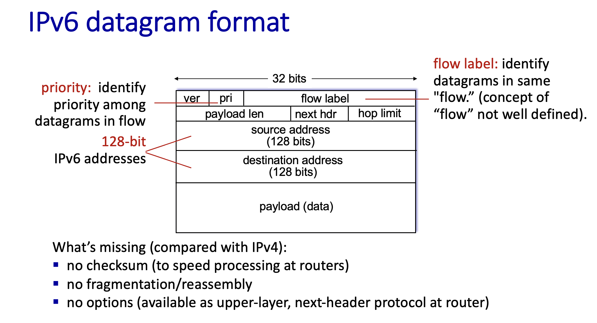

Reference: https://gaia.cs.umass.edu/kurose_ross/videos/4/

These notes are based on the course by J.F. Kurose & K.W. Ross; copyright of the course material belongs to the original authors (https://gaia.cs.umass.edu/kurose_ross/ppt.php).

### Two Planes

Data plane

- Local to a single router, e.g. deciding which output interface an arriving IP datagram leaves through. Usually implemented in hardware.

Control plane

- Network-wide: how data travels across the whole network. Usually implemented in software.

### Routers

#### Router Architecture

Router forwarding

- Destination-based forwarding
  - Uses only the destination IP; longest prefix matching yields the output interface, and the only action is "forward".

  - Longest prefix matching

    - The matching rule used when looking up the forwarding table: when several entries match, the one with the longer prefix wins.

    - TCAM (Ternary Content-Addressable Memory) is hardware that routers use to look up forwarding tables extremely fast.

      - Ordinary RAM takes an address and returns the content stored there.

      - CAM takes content and quickly returns the address where it is stored, by comparing the input against all entries simultaneously.

      - "Ternary" means each bit can be 0, 1, or X, where X matches anything.

- Generalized forwarding
  - Can match on multiple header fields and perform various actions such as forwarding, dropping, or modifying headers.

#### Switching Fabric

- A packet is only sent into the switching fabric after its output port has been determined.
- The maximum rate at which the switching fabric can move packets from input ports to output ports (all ports combined) is called the switching rate.

  - Non-blocking switch: packets never queue at the input ports; the switching rate is high enough that no packets build up at the inputs.
  - Input port queuing: the opposite of a non-blocking switch; input ports have to queue.
- Types
  - Switching via memory
    - Controlled by the CPU: the packet is first copied into memory, then to the output port; limited by memory bandwidth.
  - Switching via bus
    - Does not go through memory, so each packet only crosses the bus once; but because the bus is shared, the rate is limited by bus bandwidth.
  - Switching via interconnection network
    - Approach 1: a crossbar switch directly connects N input ports to N output ports through N² crosspoints.
    - Approach 2: multistage switching networks. For example, the figure below has four 4 $\times$ 4 switching elements and four 2 $\times$ 2 switching elements. There can be multiple paths between one input port and one output port, used in parallel.

  

- Switching equipment in backbone networks may run multiple fabric planes in parallel.

#### Queuing

##### Input Ports

- Queuing occurs when datagrams arrive faster than the switching fabric can handle them.
- Head-of-the-Line (HOL) blocking: when the head-of-line datagrams of several input ports contend for the same output port, only one can go through at a time; the others wait at the head of their own input queues. Datagrams behind them cannot be forwarded because of FIFO order, even if their own output ports are idle.

##### Output Ports

- When packets come through the switching fabric faster than the output port can send them, they queue in the output port's buffer. Congestion signals are marked on packets at this point.

#### Buffers

- A buffer temporarily stores packets that cannot be transmitted right away because of congestion.
  - Buffers serve two purposes:
    - Absorbing bursts: when a batch of packets arrives in a short time and the output link can't keep up, they are stored in the buffer instead of being dropped.
    - Keeping the link busy: after a burst, the buffer still holds packets, so the link can keep sending instead of idling. Without buffering the link alternates between "dropping packets" and "sitting idle", and utilization falls.
- Downsides of too much buffering
  - Long delays, bad for delay-sensitive applications
  - TCP congestion control becomes sluggish
- Shrinking the buffer from very large down to a critical size reduces delay without losing throughput; shrinking it further starts trading throughput for delay.
- Buffer management
  - Tail drop: when the queue is full, the newly arriving packet is dropped.
  - Priority: when the queue is full, the new packet can instead be kept and earlier packets removed according to priority.

#### Packet Scheduling in Router Buffers

- First In, First Served
- Priority scheduling
  - Send packets from the highest-priority class whose queue is non-empty.
- Round robin scheduling
  1. Classify arriving packets by some rule (e.g. by source or application type) and put each class into its own queue.
  2. The scheduler visits the queues in a fixed order, sending one complete packet from each queue per round.
  3. An empty queue is skipped and the scheduler moves on to the next one.
- Weighted fair queuing
  - A generalization of round robin: each class has a specific weight and a different guaranteed minimum bandwidth.
- The ISP decides the priority policy, e.g. judging the type of service by port, or by source IP (paying companies may get priority), and assigns priorities accordingly.

### IPv4 Header

- The IPv4 header has variable length, hence the header length field.
- The header checksum was removed in IPv6: since the TTL changes at every hop, the checksum has to be recomputed each time, which costs overhead.

### DHCP

- Uses UDP; the client uses port 68 and the server uses port 67.
- Steps for assigning an IP
  - DHCP discover (optional)
    - Source IP 0.0.0.0 (the client has no IP yet), destination IP 255.255.255.255 (the broadcast address).
    - Also carries a transaction ID, used to check whether the following DHCP offer is meant for this client.
  - DHCP offer (optional)
    - Destination IP is 255.255.255.255, carrying the earlier transaction ID.
    - The yiaddr field contains the IP assigned to the device that requested DHCP service.
  - DHCP request
    - The host has an IP it wants, either the one from the DHCP offer or one it used before, and asks the DHCP server to use it.
  - DHCP ACK
- Besides assigning an IP, DHCP can also provide the first-hop router's IP, the DNS server's IP, and the subnet mask.

### Routing on the Public Internet

- Routing IP on the public Internet also uses longest prefix matching, as shown below.

### IPv6

- Much harder to exhaust than IPv4.

- Fixed-length header, faster to process.
- Flow label: marks which flow a packet belongs to. A typical use: when there are multiple equal-cost paths to the destination, routers spread different flows across paths for load balancing, while packets of the same flow take the same path so they don't arrive out of order. How exactly it is used is up to the routers.

### Tunneling

- Some old devices may not support IPv6.
- Tunneling makes an IPv6 datagram the payload of an IPv4 datagram, so the IPv6 packet wrapped in IPv4 can be routed through IPv4 routers. At a router that supports both IPv4 and IPv6 it is unwrapped back into the original IPv6 packet and continues to its destination.

### Generalized Forwarding

- Can match on multiple header fields and perform various actions such as forwarding, dropping, or modifying headers.

---

*This post was translated from the Chinese original by Claude.*
