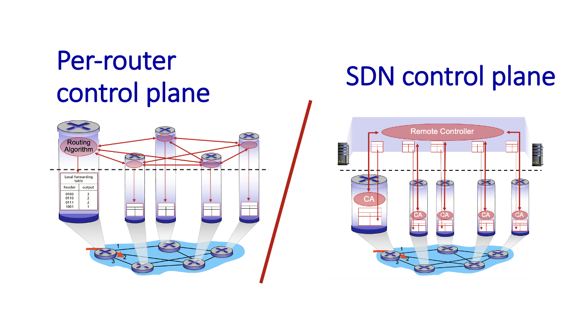
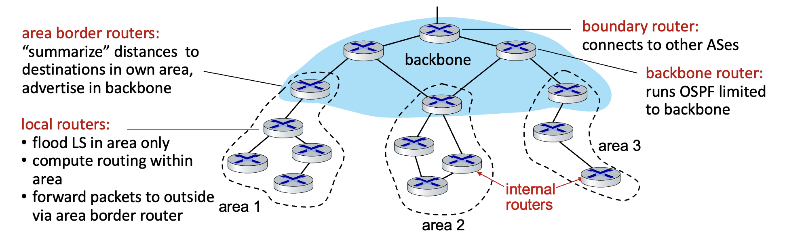

参考资料： https://gaia.cs.umass.edu/kurose_ross/videos/5/

本笔记参考 J.F. Kurose & K.W. Ross 的课程，课程内容版权归原作者所有(https://gaia.cs.umass.edu/kurose_ross/ppt.php)

### 分类

- 路由算法可以按照全局式还是分散式(是否需要知道全网所有链路的完整代价信息)，静态还是动态的来分类。
- 全局式(中心化)路由算法使用全网完整的全局信息来计算最短路径。这个计算既可以在一个地方运行（比如逻辑上集中的控制器），也可以在每台路由器上各自复制运行一份。举例：Dijkstra
- 分散式（分布式）路由算法由各路由器以迭代、分布式的方式计算最短路径。任何一个节点都不掌握全网所有链路的完整代价信息：每个节点一开始只知道与自己直连的链路代价，之后通过反复与邻居交换信息、迭代计算，逐步算出到各目的地的最短路径。举例：距离向量（DV）算法，即分布式 Bellman-Ford 算法。

### 链路状态（LS）算法：Dijkstra

- 算法应该是很熟知的
- 可以是每台路由器先广播与自己直连的链路及其代价，然后所有路由器各自运行 Dijkstra 计算；也可以由一个中心控制器统一计算。
- 当链路代价取决于链路当前的流量负载时，路由可能出现振荡：流量在不同路径之间来回切换

### 距离向量（DV）算法：Bellman-Ford

- 距离向量： 它是一台路由器手里的一张表：列出"我到网络中每个目的地的当前最短距离估计"。

$$D_x(y) = \min_v \left\{ c_{x,v} + D_v(y) \right\}$$

距离更新的核心公式如上，x到y的最短距离，是x的每一个邻居v到y的最短距离，加上x到v的距离的最小值。

- 计算的逻辑见下图



- 动态拓扑是距离向量真正的弱点。例如 A–B–C 一条线，B 到 C 的链路断了。B 本该得知 C 不可达，但 A 还在报"我到 C 距离是 2"。B 看不到拓扑，不知道 A 的这条路其实就是经过 B 自己，于是误以为"经 A 可以到 C，距离 3"。A 再根据 B 更新成 4，B 又更新成 5……两者互相抬高，在 A、B 之间形成路由环路。
- 一旦有路由器配置错误，说自己和网络上所有节点距离都是一个超级小的值，会导致网络上的路由问题。

### 公网路由

- 然后在实际场景中，需要考虑可扩展性与自治性。自治性说的是，互联网的每一个网络都有自己的运营者，他们内部用什么路由协议，该网络向外发出的流量走哪条路径，别人的流量到他这里被如何转发，都由他们说了算。
- 分为在AS自治域内部路由(intra-domain routing)，在自治域之间路由(inter-domain routing)两种情况。对于intra-domain routing，不同AS可以用不同协议。
- gateway router（网关路由器，也叫边界路由器）是 AS 里有链路直接连到其他 AS 的那台路由器。它同时干两份活：
  - 对外：和相邻 AS 的网关跑 BGP，交换"能到达哪些前缀"的信息；
  - 对内：它本身也是 AS 内部的一台普通路由器。

### Intra-domain Routing 

- Routing Information Protocol(RIP):是一种距离向量协议
- OSPF(Open Shortest Path First)：使用Dijkstra算法
- EIGRP(Enhanced Interior Gateway Routing Protocol)

### OSPF

- 每台路由器先广播与自己直连的链路及其代价，然后所有路由器各自运行类似于 Dijkstra的计算

### hierarchical OSPF

### BGP: the Border Gateway Protocol

- 它是基于路径向量的协议
- BGP可以让自治系统：
  - 从周围的AS获取网络可达性的信息(eBGP)
  - 依据可达性和政策，决定去向其他网络的路由
  - 把网络可达性信息传递给自治系统内部的路由器(iBGP)
  - 告诉周围的AS它能到达的网络(eBGP)
- 然后，边界路由器或者网关路由器，它是既跑iBGP也跑eBGP的
- BGP message
  - OPEN: 建立tcp连接后发送的第一个报文，认证发送 OPEN 的 BGP 对等路由器
  - UPDATE: 添加新路由或者删除旧路由
  - KEEPALIVE
    - 在建立会话阶段，收到对方的 OPEN 之后要回一个 KEEPALIVE，表示确认接受这个 OPEN，会话才进入 Established 状态。
    - 两个peer之间，如果没有UPDATE要发，就应当定期发送KEEPALIVE。如果到指定的时间既没有收到对方的UPDATE，也没有收到对方的KEEPALIVE，就认为对面这个peer失效，关闭连接，并且撤销从这个peer中学习到的路由。
  - NOTIFICATION:报告错误，或者关闭连接
- BGP path advertisement
  - 公告终点的ip地址的前缀
  - 附带属性
    - AS-PATH: 数据包从发送方 AS 去往该前缀要经过的 AS 序列
    - NEXT-HOP: NEXT-HOP 是这条路由所经过的下一跳 AS 的网关路由器上，连向本 AS 的那个接口的 IP 地址。
  - 可以依据ISP自己定制的策略不公告特定的路由
- Hot potato routing
  - AS内部主机需要发消息给其它的AS的时候，在能到达目的前缀的网关中，选择 AS 内部路由代价最小的那个。
  - 需要注意的是，Hot potato routing并不是唯一的规则，可能存在比它优先级更高的路由规则。
- ICMP
  - 也在ip包的payload中，但是我们不认为它是传输层协议。
  - ttl减到0了之后，路由器可能会回icmp表示相应的信息。UDP传输到终点以后，如果端口未开放，终点的主机也会回icmp
