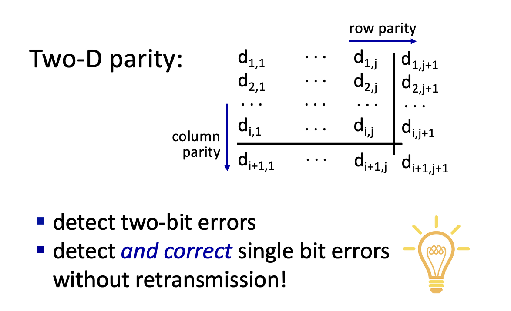
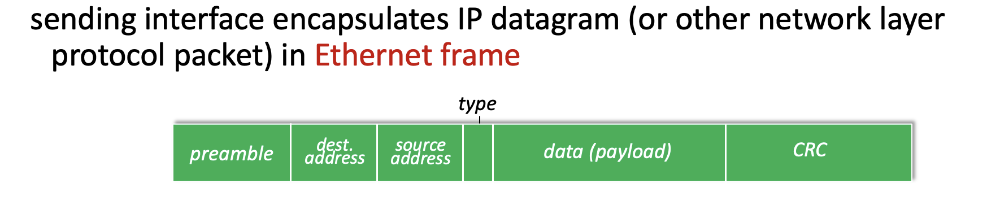
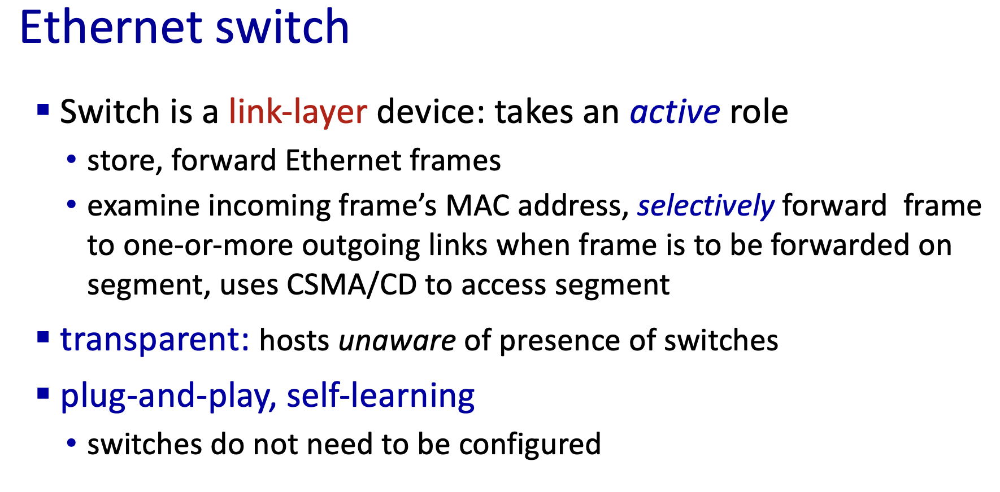
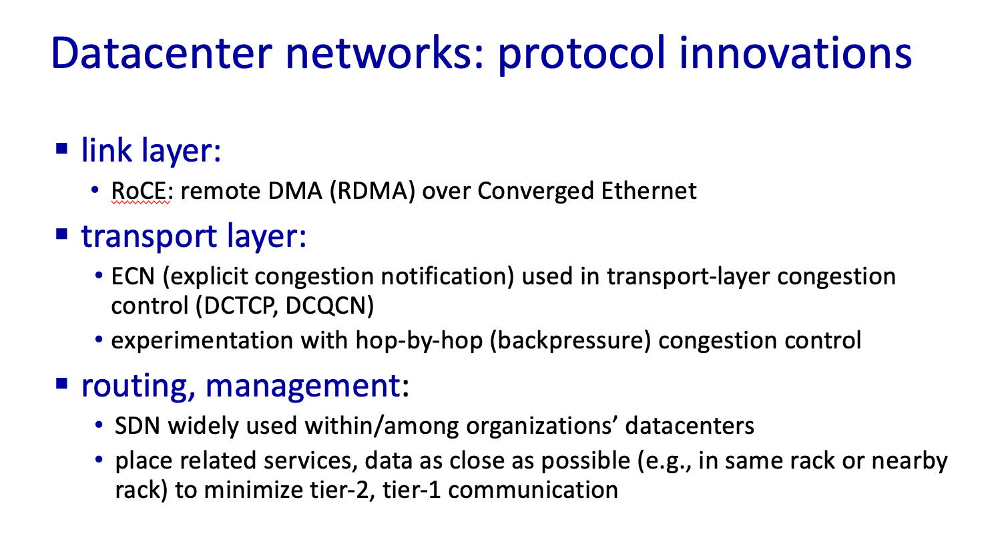

Reference: https://gaia.cs.umass.edu/kurose_ross/videos/6/

These notes are based on the course by J.F. Kurose & K.W. Ross; copyright of the course material belongs to the original authors (https://gaia.cs.umass.edu/kurose_ross/ppt.php).

This chapter covers the data link layer.

The link layer is responsible for carrying a datagram across a link, from one node to a physically adjacent node.

A link-layer frame wraps the IP-layer datagram with a header and a trailer, and uses MAC addresses to identify the source and destination.

### Error detection

- Add a parity bit.

- Checksum
- Cyclic redundancy check (CRC)
  - The sender and receiver agree in advance on an (r+1)-bit generator G (specified by the CRC standard).
  - The sender appends r zeros to the data D and divides by G; the r-bit remainder is the check bits R. R is sent appended to D, and `<D,R>` is then exactly divisible by G.
  - The receiver divides the received `<D,R>` by G. A remainder of 0 means no error was detected; a non-zero remainder means an error occurred.
  - The division uses mod-2 arithmetic: subtraction is done bit by bit with no borrows, which is equivalent to XOR and easy to implement in hardware.

### Multiple access protocols

A channel is the transmission medium or path that a signal travels through from one node to another.

Types of links:

- Point-to-point
  - A link has exactly one sender and one receiver.
- Broadcast
  - Multiple sending and receiving nodes are all attached to the same shared channel; when any node transmits a frame, the channel broadcasts it and every other node receives a copy.

Multiple access protocols:

- A distributed algorithm that decides when each node may transmit.
- The communication needed to coordinate channel use must itself happen over that same channel.

Three approaches:

- Channel partitioning
  - Time division multiple access: time is divided into slots, and nodes take turns using fixed slots; if a node has nothing to send in its slot, the slot goes idle.
  - Frequency division multiple access:
- Random access
  - A node transmits at the full link rate.
  - The main work is detecting collisions and recovering from them.
- Taking turns

### MAC addresses and ARP

- ARP: when a host knows the IP address of a node on the same subnet, it broadcasts an ARP request on the LAN asking for the MAC address that corresponds to that IP; the node that owns the IP replies with its MAC address via unicast. The requester stores this IP-to-MAC mapping in its ARP table. Entries carry a TTL, are deleted when they expire, and are queried again when needed.
  - If the destination IP is not on the local subnet, the host looks up the MAC address of the default gateway instead, and hands the frame to the router to forward.

### Ethernet frame

- Preamble: the first 7 bytes are all `10101010`, and the 8th byte is `10101011`. The regular alternation of 1s and 0s in the first 7 bytes lets the receiver's NIC lock onto the sender's clock rate and align its sampling times. The last two bits of the 8th byte are a consecutive `11`, breaking the `10` pattern; when the receiver sees `11` it knows the preamble has ended and the actual frame content follows.
- Type: indicates the higher-layer protocol.

- Ethernet frames do not guarantee reliable delivery.

### Switches

- A switch receives complete frames at the link layer and forwards them only to the destination port, without copying the signal to other ports, so each port's link is its own separate collision domain. If a port's link is full-duplex, no collisions occur on that link.
- When several frames need to go out the same port at once, the switch buffers and queues them, avoiding collisions on the outgoing link.
- A switch's forwarding table is built from the source MAC addresses of incoming frames, and entries are deleted when they expire.
- When forwarding by MAC address: if the destination MAC's port is known and is not the incoming port, the switch forwards the frame there; if the destination port is the incoming port, it drops the frame; otherwise it floods the frame to all ports except the incoming one.
- A switch can be divided into VLANs, each of which is a separate broadcast domain.
- Traffic between different VLANs has to be routed: either through an external router, or by a layer-3 switch, which configures a virtual interface (SVI) for each VLAN to act as that subnet's gateway.
- When frames travel between switches over a trunk link, the switch inserts an 802.1Q tag, which the receiving switch uses to identify which VLAN the frame belongs to.

### Datacenter networks

---

*This post was translated from the Chinese original by Claude.*
