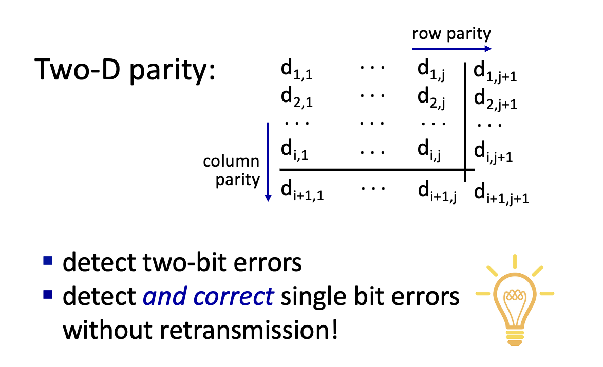
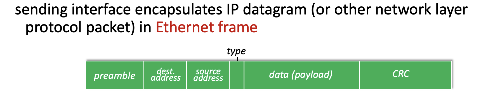
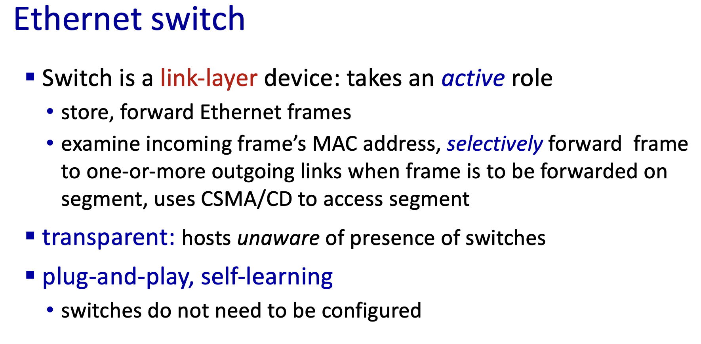
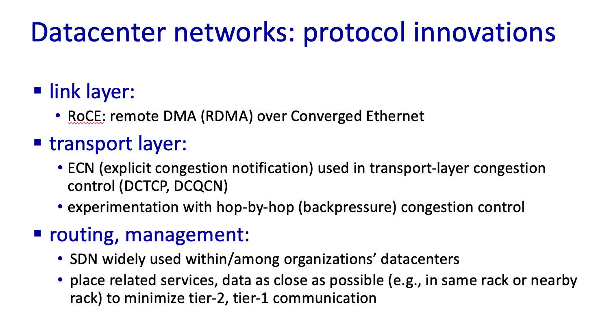

参考资料： https://gaia.cs.umass.edu/kurose_ross/videos/6/

本笔记参考 J.F. Kurose & K.W. Ross 的课程，课程内容版权归原作者所有(https://gaia.cs.umass.edu/kurose_ross/ppt.php)

本章内容：数据链路层。

链路层负责通过链路，将数据报从一个节点传输到与其物理相邻的另一个节点。

链路层的frame对ip层的datagram加了header与trailer，然后依靠mac地址来标识源与目的地址。

### Error detection

- 加一个奇偶校验位。

- checksum
- Cyclic redundancy check(CRC)
  - 发送方和接收方事先约定一个 r+1 位的生成数 G（由 CRC 标准规定）。
  - 发送方把数据 D 后面补 r 个 0，再除以 G，得到的 r 位余数就是校验位 R。R 接在 D 后面一起发送，此时 `<D,R>` 恰好能被 G 整除。
  - 接收方用 G 去除收到的 `<D,R>`，余数为 0 则认为无误，余数不为 0 则说明出错。
  - 这个除法使用 mod 2 运算：每一位相减时不借位，等价于 XOR（异或），便于硬件实现。

### Multiple Access protocols

Channel（信道）指的是信号从一个节点传到另一个节点所经过的传输媒介或通路.

link分类

- Point-to-point
  - 一条链路只有一个发送方与接收方
- Broadcast 
  - 多个发送和接收节点共同连接在同一条共享信道上；任何一个节点发出帧时，信道会把它广播出去，其他所有节点都会收到一份拷贝。

Multiple access protocols

- 是一个分布式算法，决定每个节点什么时候可以发送消息
- 协调信道使用所需的通信，也只能通过这条信道本身进行

三种方式

- channel partitioning
  - time division multiple access：按时间划分时隙，各节点轮流使用固定的时隙；若某节点在自己的时隙内没有数据要发，该时隙空闲。
  - frequency division multiple access:
- random access
  - 发的时候直接按照链路最大速率来发
  - 需要做的主要是，检测冲突与从冲突中恢复
- taking turns

### mac地址与arp

- arp：主机已知同一子网内某个节点的 IP 地址时，在局域网内广播 ARP 请求，询问该 IP 对应的 MAC 地址；拥有该 IP 的节点以单播方式回复自己的 MAC 地址。请求方把这条 IP-MAC 映射存入 ARP 表，表项带有 TTL，过期后删除，需要时重新查询。
  - 若目的 IP 不在本子网，主机查询的是默认网关的 MAC 地址，先把帧交给路由器转发。

### 以太网帧

- Preamble:前 7 个字节都是 `10101010`,第 8 个字节是 `10101011`。前 7 个字节的 1 和 0 规律交替，接收方的网卡可以从这串信号里锁定发送方的时钟节奏，让自己的采样时刻对齐。第 8 个字节最后两位是连续的 `11`，打破了前面 `10` 的交替规律。接收方看到 `11` 就知道前导码结束了，接下来就是帧的正式内容。
- Type: 表示更上层的协议。

- 以太网帧不保证可靠传输

### 交换机

- 交换机在链路层接收完整的帧，只向目标端口转发，不会把信号复制到其他端口，因此每个端口的链路各自是一个独立的冲突域。若端口链路为全双工，该链路上不会发生冲突。
- 多个帧同时要发往同一个端口时，交换机把它们存入缓存排队发送，避免在输出链路上发生冲突。
- 交换机的forwarding table是由发进来的帧的source mac来构建起来的，并且条目过期后会删除。
- 交换机在依据mac转发的时候，如果目的mac的端口是已知的并且非源端口，那么直接转发；如果目的端口是源端口则丢弃；否则发给除了源端口的所有端口。
- 交换机可以划分 VLAN，每个 VLAN 是一个独立的广播域。
- 不同 VLAN 之间的通信需要经过路由：可以通过外部路由器完成，也可以由三层交换机完成，后者为每个 VLAN 配置一个虚拟接口（SVI）作为该子网的网关。
- 帧在交换机之间经 trunk 链路传输时，交换机为其插入 802.1Q 标签，接收方交换机据此识别该帧所属的 VLAN。

### 数据中心网络

